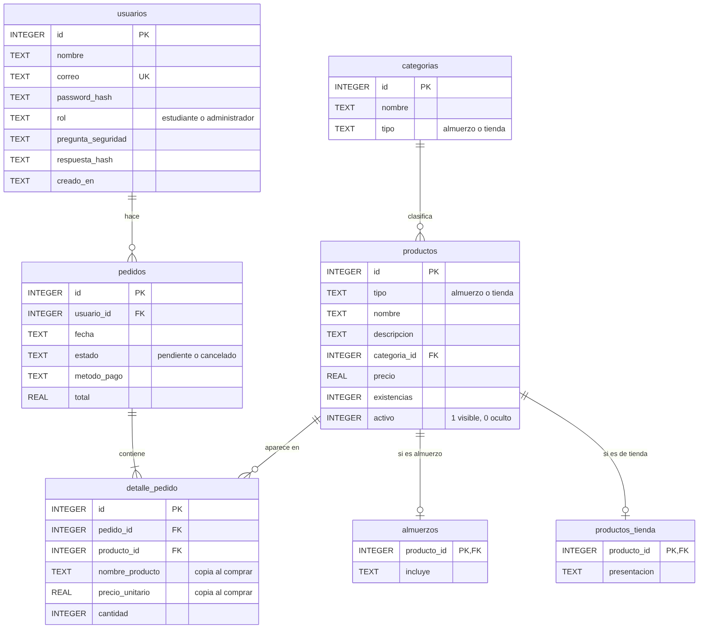

# Cómo funciona la base de datos

## Qué es y cuál usamos

Una **base de datos** guarda la información de forma permanente: aunque se apague el servidor, los usuarios, productos y pedidos siguen ahí. Sin ella, todo se perdería cada vez que se reinicia `app.py`.

Usamos **SQLite**:
- Es una base de datos **relacional**: guarda los datos en **tablas** (filas y columnas) y se consulta con el lenguaje **SQL**.
- Toda la base es **un solo archivo**: `instancia/kiuvo.db`.
- **Viene incluida en Python** (`import sqlite3`): no hay que instalar ningún servidor, a diferencia de MySQL o PostgreSQL.
- Es suficiente para un sitio de una cafetería. Un sistema con miles de usuarios al mismo tiempo usaría MySQL o PostgreSQL; el SQL que escribimos sería casi igual.

## Las 7 tablas



| Tabla | Guarda | Una fila es… |
|---|---|---|
| `usuarios` | Estudiantes y administradores | Una cuenta |
| `categorias` | Las categorías del menú y de la tienda | Una categoría: "Bebidas" (tienda), "Vegetariano" (almuerzo)… |
| `productos` | Lo **común** a todos los productos | Un producto con su nombre, categoría, precio y existencias |
| `almuerzos` | Lo **propio** de los almuerzos | Qué incluye un almuerzo ("Arroz, ensalada y fresco") |
| `productos_tienda` | Lo **propio** de la tienda | La presentación de un producto ("Botella 600 ml") |
| `pedidos` | El encabezado de cada compra | Un pedido: quién, cuándo, estado, método de pago y total |
| `detalle_pedido` | Lo que lleva cada pedido | Una línea: "2 × Pollo guisado a $3.50" |

### Conceptos clave

- **Llave primaria (PK):** la columna `id` identifica cada fila sin repetirse. `AUTOINCREMENT` hace que SQLite la asigne sola (1, 2, 3…).
- **Llave foránea (FK):** una columna que apunta al `id` de otra tabla. `pedidos.usuario_id` dice de quién es el pedido. Con `PRAGMA foreign_keys = ON`, SQLite no deja guardar un pedido de un usuario que no existe.
- **UNIQUE:** `usuarios.correo` no se puede repetir; dos cuentas no pueden tener el mismo correo.
- **CHECK:** reglas que la base revisa sola. Por ejemplo, `precio >= 0`, `existencias >= 0` y `rol IN ('estudiante', 'administrador')`. Es una segunda barrera además de las validaciones de las clases.

### Las relaciones

- **Un usuario hace muchos pedidos** (uno a muchos): `pedidos.usuario_id → usuarios.id`.
- **Un pedido tiene muchas líneas** (uno a muchos): `detalle_pedido.pedido_id → pedidos.id`.
- **Un producto aparece en muchas líneas** (uno a muchos): `detalle_pedido.producto_id → productos.id`.
- **Una categoría tiene muchos productos** (uno a muchos): `productos.categoria_id → categorias.id`.
- **Un producto tiene un solo detalle** (uno a uno): `almuerzos.producto_id → productos.id` o `productos_tienda.producto_id → productos.id`. Aquí `producto_id` es a la vez llave primaria y foránea, así que no puede haber dos detalles para el mismo producto.

Entre pedidos y productos la relación es **muchos a muchos**: un pedido tiene varios productos y un producto está en varios pedidos. En SQL eso se resuelve con una tabla intermedia, que aquí es `detalle_pedido`. Además guarda la cantidad y el precio de ese momento.

### Normalización: por qué hay tablas separadas

**Normalizar** es organizar las tablas para que cada dato se guarde **una sola vez** y no queden columnas vacías o repetidas. El profesor lo pidió en la revisión, y se aplicó así:

**1. Tabla `categorias`.** Antes cada producto guardaba el texto de su categoría ("Bebidas", "Bebidas", "Bebidas"…). Si alguien escribía "bebidas" o "Bebida", quedaban como categorías distintas, y cambiar el nombre obligaba a editar todos los productos. Ahora la categoría se escribe una vez en `categorias` y cada producto solo guarda su `categoria_id`.

**2. Tablas `almuerzos` y `productos_tienda`.** Antes las dos clases compartían una tabla y siempre quedaba una columna vacía: los productos de tienda tenían `incluye` en `NULL` y los almuerzos tenían `presentacion` en `NULL`. Ahora:
- `productos` guarda lo que tienen **todos** (lo de la clase `Producto`).
- `almuerzos` guarda solo lo propio de `Almuerzo` (`incluye`).
- `productos_tienda` guarda solo lo propio de `ProductoTienda` (`presentacion`).

Esto refleja la **herencia** de las clases: la tabla padre tiene los datos comunes y cada tabla hija sus datos propios. Se le llama **herencia de tabla por clase**.

**3. La base impide categorías de otro tipo.** `productos` tiene una llave foránea doble, `(categoria_id, tipo) → categorias(id, tipo)`. Así SQLite rechaza un almuerzo en la categoría "Bebidas", aunque alguien se salte las validaciones de Python.

Para leer un producto completo se **unen** las tablas con `JOIN`:

```sql
SELECT p.nombre, p.precio, c.nombre AS categoria, a.incluye, t.presentacion
FROM productos p
JOIN categorias c            ON c.id = p.categoria_id
LEFT JOIN almuerzos a        ON a.producto_id = p.id
LEFT JOIN productos_tienda t ON t.producto_id = p.id
```

`LEFT JOIN` se usa porque cada producto tiene fila en **una** de las dos tablas de detalle, no en las dos.

**Lo que se dejó sin separar, a propósito:**
- `detalle_pedido` copia el nombre y el precio, y `pedidos` guarda el total (ver la siguiente sección). No es repetición: es el registro histórico de lo que se cobró.
- `rol`, `estado` y `metodo_pago` son textos con una lista fija de valores, revisada con `CHECK` o en el código. Separarlos en tablas solo tendría sentido si el administrador pudiera crear roles o estados nuevos.

### ¿Por qué `detalle_pedido` copia el nombre y el precio?

Si mañana el admin sube el pollo de $3.50 a $4.00, el pedido de ayer debe seguir diciendo $3.50. Por eso cada línea guarda su propio `precio_unitario` y `nombre_producto`.

### ¿Por qué los productos se "ocultan" en vez de borrarse?

Un producto que ya aparece en pedidos no se puede borrar sin romper esos pedidos (la llave foránea lo impide). Por eso el admin lo **oculta** (`activo = 0`): deja de verse en el catálogo, pero el historial sigue completo.

---

## Cómo se conecta el código con la base

```
Ruta (rutas/*.py)  →  Servicio (servicios.py)  →  DAO (carpeta dao/)  →  BaseDatos (base_datos.py)  →  kiuvo.db
     página               reglas del negocio          objetos ⇄ filas SQL             conexión y tablas
```

1. **`BaseDatos`** abre la conexión y crea las tablas con `CREATE TABLE IF NOT EXISTS`. Por eso la primera vez la base se crea sola y las siguientes no se toca. Si encuentra una base de la versión anterior (sin normalizar), la **actualiza sola** sin perder productos ni pedidos (método `_migrar_desde_version_1`).
2. Los **DAO** son los únicos que escriben SQL. Todos implementan la interfaz `DAO` (`insertar`, `buscar_por_id`, `listar`, `actualizar`, `eliminar`) y convierten filas en objetos y objetos en filas:

```python
# dao/producto_dao.py — leer: fila → objeto
fila = con.execute("SELECT * FROM productos WHERE id = ?", (producto_id,)).fetchone()
producto = Producto.construir(fila["tipo"], nombre=fila["nombre"], precio=fila["precio"], ...)
# Producto.construir devuelve un Almuerzo o un ProductoTienda según fila["tipo"]
# (la consulta real une productos, categorias, almuerzos y productos_tienda con JOIN)
```

```python
# dao/producto_dao.py — guardar: objeto → fila
con.execute("INSERT INTO productos (tipo, nombre, categoria_id, precio, ...) VALUES (?, ?, ?, ?, ...)",
            (producto.tipo, producto.nombre, categoria_id, producto.precio, ...))
# y después, en la tabla de su tipo (polimorfismo):
#   Almuerzo       → INSERT INTO almuerzos (producto_id, incluye)
#   ProductoTienda → INSERT INTO productos_tienda (producto_id, presentacion)
```

3. El resto del programa trabaja **solo con objetos** y nunca ve SQL.

## Consultas con parámetros (seguridad)

**Nunca** se pega lo que escribe el usuario dentro del SQL:

```python
# MAL — inyección SQL: si alguien escribe  ' OR '1'='1  entra sin contraseña
con.execute(f"SELECT * FROM usuarios WHERE correo = '{correo}'")

# BIEN — el ? se reemplaza de forma segura; el texto nunca se ejecuta como SQL
con.execute("SELECT * FROM usuarios WHERE correo = ?", (correo,))
```

Todas las consultas del proyecto usan `?`.

## Transacciones: todo o nada

Confirmar una compra son varios pasos: crear el pedido, descontar cada producto y guardar cada línea. Si a medio camino falla uno (por ejemplo, otra estudiante compró el último brownie un segundo antes), no puede quedar un pedido a medias.

```python
# base_datos.py
with base_datos.conexion() as con:
    ...  # varios INSERT y UPDATE
# Si todo salió bien → commit (se guarda todo)
# Si hubo cualquier error → rollback (se deshace todo)
```

Además, el descuento solo se hace si hay suficiente:

```sql
UPDATE productos SET existencias = existencias - 2
WHERE id = 7 AND existencias >= 2
```

Si no alcanza, no se actualiza ninguna fila, el código lanza `InventarioInsuficiente` y la transacción se deshace. Así **nunca** quedan existencias negativas, aunque dos personas compren al mismo tiempo. Cancelar un pedido funciona igual: marca el pedido como cancelado y devuelve las existencias en una misma transacción.

## Qué se guarda y qué no

| Dato | ¿Se guarda? |
|---|---|
| Contraseña | **No.** Solo su *hash* (`password_hash`), que no se puede revertir. |
| Respuesta de seguridad | **No.** Solo su hash (`respuesta_hash`). |
| Carrito | No va en la base de datos: vive en la sesión del navegador hasta que se paga. |
| Datos de tarjeta | No se piden ni se guardan (el pago es simulado). |

## Cómo ver la base de datos por dentro

- **DB Browser for SQLite** (gratis, https://sqlitebrowser.org): abre `instancia/kiuvo.db` y muestra las tablas como una hoja de cálculo.
- **VS Code:** la extensión "SQLite Viewer".
- **Desde Python:**

```python
import sqlite3
con = sqlite3.connect("instancia/kiuvo.db")
for fila in con.execute("SELECT nombre, existencias FROM productos"):
    print(fila)
```

## Errores de la base de datos

Si SQLite rechaza algo, el usuario no ve un error técnico: la clase `DAO` lo convierte en un mensaje claro.

| Qué pasó | Error de SQLite | Excepción propia | Mensaje |
|---|---|---|---|
| Producto con nombre repetido | `UNIQUE constraint failed` | `RegistroDuplicado` | "Ya existe un producto con ese nombre." |
| Borrar un producto que ya se vendió | `FOREIGN KEY constraint failed` | `RegistroEnUso` | "Este producto ya aparece en pedidos… Puedes ocultarlo." |
| Borrar algo que no existe | (0 filas afectadas) | `RegistroNoEncontrado` | "Ese producto no existe." |
| No se puede abrir el archivo, disco lleno… | `OperationalError` | `ErrorBaseDatos` | "No se pudo acceder a la base de datos…" |

En todos los casos la transacción se deshace (`rollback`), así que la base nunca queda a medias.

## Preguntas que les pueden hacer

**¿Dónde se guardan los datos?** En SQLite, en el archivo `instancia/kiuvo.db`, en 7 tablas relacionadas.

**¿Está normalizada?** Sí. Cada dato se guarda una vez: las categorías están en su propia tabla, los datos propios de almuerzos y de tienda en tablas separadas (sin columnas vacías) y los pedidos separados en encabezado (`pedidos`) y líneas (`detalle_pedido`).

**¿Por qué SQLite?** Viene con Python, no requiere instalar un servidor y es suficiente para este sitio. Cambiar a MySQL solo afectaría a `BaseDatos` y a los DAOs, porque el resto del código no escribe SQL.

**¿Cómo se relacionan las tablas?** Con llaves foráneas: un usuario tiene muchos pedidos, un pedido tiene muchas líneas en `detalle_pedido`, cada línea apunta a un producto, cada producto pertenece a una categoría y tiene su detalle en `almuerzos` o en `productos_tienda`.

**¿Cómo se relaciona la base con las clases?** Cada tabla corresponde a una clase (`usuarios` → `Usuario`, `productos` → `Producto`, `almuerzos` → `Almuerzo`, `productos_tienda` → `ProductoTienda`, `pedidos` → `Pedido`, `detalle_pedido` → `ItemPedido`). La herencia de las clases se refleja en las tablas: la tabla padre (`productos`) tiene lo común y cada tabla hija lo propio. Los DAO convierten filas en objetos y al revés.

**¿Cómo se evita la inyección SQL?** Con consultas parametrizadas (`?`).

**¿Qué es el patrón DAO?** Una capa de clases que se encarga solo de leer y guardar en la base de datos. Tenemos una interfaz (`DAO`, clase abstracta) con las operaciones CRUD, y una implementación por cada entidad: `UsuarioDAO`, `CategoriaDAO`, `ProductoDAO` y `PedidoDAO`. La lógica (servicios) y la interfaz (rutas) nunca escriben SQL.

**¿Dónde está el CRUD completo?** En cada DAO. En la página, el administrador lo usa con los productos: crear (+ Almuerzo / + Producto de tienda), leer (Inventario), actualizar (Editar, Ocultar, Reponer) y eliminar (Eliminar).

**¿Qué pasa si dos personas compran el último producto a la vez?** El `UPDATE ... WHERE existencias >= cantidad` dentro de una transacción garantiza que solo una compra lo consigue; la otra recibe el aviso de inventario insuficiente.

**¿Las contraseñas se pueden ver en la base?** No: solo está el hash.
